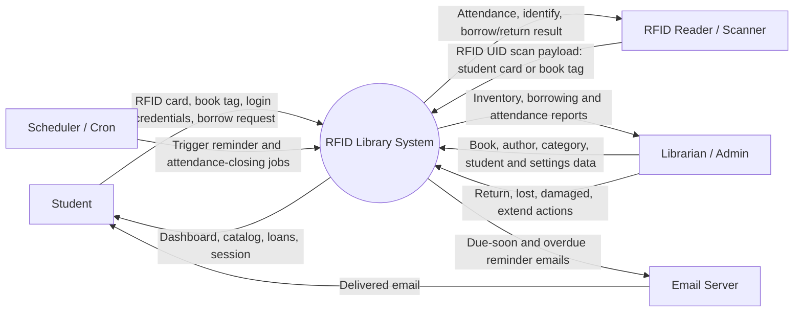
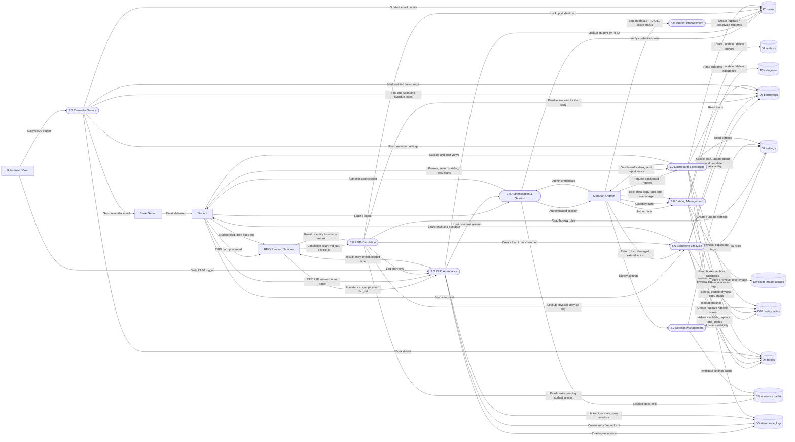

# Data Flow Diagram — RFID Library System

This document describes the data flows of the RFID Library System (Laravel application).
It uses two levels of detail:

- **Level 0 (Context Diagram)** — the system as a single process and its external entities.
- **Level 1 (Detailed DFD)** — the internal processes, data stores, and data flows.

## Notation

| Symbol | Mermaid shape | Meaning |
| --- | --- | --- |
| Rectangle | `Entity[Name]` | External entity (actor or external system) |
| Rounded / stadium | `Process([1.0 Name])` | Process |
| Cylinder | `Store[(D1 Name)]` | Data store |
| Arrow | `-->|label|` | Data flow |

---

## Level 0 — Context Diagram

---

## Level 1 — Detailed DFD

---

## Data Dictionary

| ID | Data store | Backing table / location | Key attributes |
| --- | --- | --- | --- |
| D1 | users | `users` | id, name, email, password, role (admin/student), rfid_uid, student_number, course, year_level, phone, is_active |
| D2 | authors | `authors` | id, name, bio |
| D3 | categories | `categories` | id, name, description |
| D4 | books | `books` | id, title, author_id → D2, category_id → D3, isbn, description, cover_image → D9, published_year, shelf_location, total_copies, available_copies (derived from D10), deleted_at |
| D5 | borrowings | `borrowings` | id, user_id → D1, book_id → D4, book_copy_id → D10, borrowed_at, due_at, returned_at, status (borrowed/returned/lost/damaged), due_soon_notified_at, overdue_notified_at, handled_by_id → D1 |
| D6 | attendance_logs | `attendance_logs` | id, user_id → D1, rfid_uid, entry_at, exit_at, source (scan_page/api/kiosk), ip_address, user_agent, closed_automatically |
| D7 | settings | `settings` | key, value — library_name, borrow_days, max_books, due_soon_days, auto_close_hours |
| D8 | sessions / cache | `sessions` table, cache store | Session id, user_id, payload, last_activity; cached `library.settings`; pending kiosk student sessions `rfid.pending.*` |
| D9 | cover-image storage | `storage/app/public/covers` | Uploaded book cover image files |
| D10 | book_copies | `book_copies` | id, book_id → D4, rfid_uid (unique), status (available/borrowed/lost/damaged) |

---

## Process Descriptions

| Process | Inputs | Outputs | Data stores |
| --- | --- | --- | --- |
| 1.0 Authentication & Session | Student RFID card, admin email/password | Authenticated session, role-based redirect | D1, D8 |
| 2.0 RFID Attendance | RFID UID (web form, `POST /api/rfid/scan`, or kiosk entry), scheduler trigger | Entry/exit log, login session, auto-closed sessions | D1, D6 |
| 3.0 Catalog Management | Author, category, book data, copy tags, cover image | Created/updated/deleted catalog records and physical copies | D2, D3, D4, D9, D10 |
| 4.0 Student Management | Student profile, RFID UID, active flag | Student records, RFID registration | D1 |
| 5.0 Borrowing Lifecycle | Borrow request, return/lost/damaged/extend actions, copy selection | Loan records, updated copy status and availability | D4, D5, D7, D10 |
| 6.0 RFID Circulation | Kiosk scan (`POST /api/rfid/circulation`): student card or book tag, device_id | Identify, borrow, or return result; entry log; pending session | D1, D4, D5, D6, D7, D8, D10 |
| 7.0 Reminder Service | Scheduled trigger, due-soon/overdue loans | Reminder emails, notified timestamps | D1, D4, D5, D7 |
| 8.0 Settings Management | Library settings form | Updated settings, cleared cache | D7, D8 |
| 9.0 Dashboard & Reporting | Page/report requests, search filters | Dashboards, catalog, loan and attendance views | D1, D4, D5, D6, D7, D10 |

---

## Notes and Assumptions

- Physical copies are tracked individually in `book_copies`, each with its own RFID tag. `books.total_copies` and `books.available_copies` are counters derived from copy status.
- The kiosk flow is: tap the student card (logs entry only and opens a short pending session), then tap a book copy tag. Tapping a copy already on loan to that student returns it; otherwise the copy is borrowed. Pending sessions are scoped by `device_id` (or client IP when omitted).
- Lost and damaged copies remain in `book_copies` for records but are excluded from circulation counters.
- The system does not calculate or charge fines. Loans can still be marked overdue, lost, or damaged and are tracked by status.
- The RFID reader is an external system that authenticates with the `X-RFID-Key` header. `POST /api/rfid/scan` keeps the attendance toggle behavior; `POST /api/rfid/circulation` handles kiosk borrow/return.
- The scheduler runs two commands: reminder emails at 08:00 and stale attendance closing at 23:30.
- Settings are cached; writes invalidate the `library.settings` cache entry.
