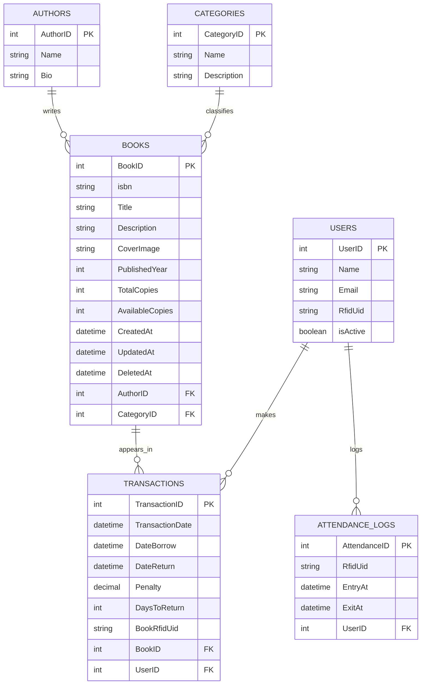

# Entity Relationship Diagram

This ERD follows the six-entity design recommended by the research professor.

## ERD-to-database mapping

Physical column names remain Laravel snake_case. The ERD labels above are exposed through model accessors and this mapping.

| ERD label | Physical column | Notes |
| --- | --- | --- |
| `UserID` | `users.id` | Also `transactions.user_id` and `attendance_logs.user_id` |
| `Name`, `Email`, `RfidUid`, `isActive` | `users.name`, `users.email`, `users.rfid_uid`, `users.is_active` | Student/admin identity |
| `AuthorID`, `Name`, `Bio` | `authors.id`, `authors.name`, `authors.bio` | Author catalog data |
| `CategoryID`, `Name`, `Description` | `categories.id`, `categories.name`, `categories.description` | Category catalog data |
| `BookID`, `isbn`, `Title`, `Description`, `CoverImage`, `PublishedYear`, `TotalCopies`, `AvailableCopies`, `CreatedAt`, `UpdatedAt`, `DeletedAt` | `books.id`, `books.isbn`, `books.title`, `books.description`, `books.cover_image`, `books.published_year`, `books.total_copies`, `books.available_copies`, `books.created_at`, `books.updated_at`, `books.deleted_at` | `AuthorID` and `CategoryID` map to `books.author_id` and `books.category_id` |
| `TransactionID` | `transactions.id` | Loan/fine transaction record |
| `TransactionDate` | `transactions.created_at` | Exposed as `transaction_date` |
| `DateBorrow` | `transactions.borrowed_at` | Exposed as `date_borrow` |
| `DateReturn` | `transactions.returned_at` | Exposed as `date_return` |
| `Penalty` | `transactions.penalty` | Merged from the former separate fine records |
| `DaysToReturn` | `transactions.days_to_return` | Recalculated when a due date changes |
| `BookRfidUid` | `transactions.book_rfid_uid` | Snapshot of the tapped book tag |
| `AttendanceID` | `attendance_logs.id` | Attendance session record |
| `EntryAt`, `ExitAt` | `attendance_logs.entry_at`, `attendance_logs.exit_at` | Door/kiosk attendance times |

## Supporting implementation tables

The following tables remain in the database because the running application needs them, but they are intentionally omitted from the professor's conceptual ERD:

- `book_copies` — tracks individual physical copies and their RFID tags.
- `settings` — stores configurable library rules.
- `notifications` — Laravel database notifications for admins.
- `sessions`, `cache`, `cache_locks`, `jobs`, `job_batches`, `failed_jobs`, `password_reset_tokens`, `personal_access_tokens` — Laravel framework tables.
